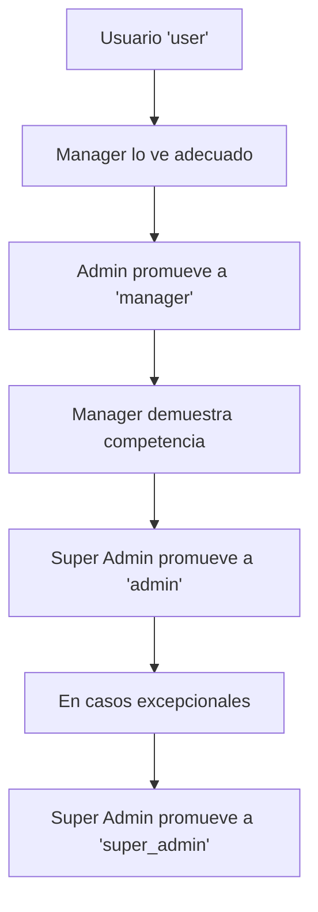

# 🔐 Sistema de Roles y Permisos - Farmacia API

## 📋 Visión General

Se ha implementado un sistema completo de roles jerárquicos para proteger las rutas de administración y gestionar permisos de usuarios de manera escalable.

## 🎭 Jerarquía de Roles

```python
ROLE_HIERARCHY = {
    "user": 0,           # Usuario normal
    "manager": 1,        # Puede ver reportes
    "admin": 2,          # Puede gestionar usuarios
    "super_admin": 3     # Puede promover a admin
}
```

### 👤 **User (Nivel 0)**
- **Descripción**: Usuario normal con permisos básicos
- **Permisos**:
  - Leer productos
  - Crear órdenes
  - Gestionar su propio perfil
  - Ver sus propias órdenes
  - Gestionar carrito de compras
  - Escribir reseñas

### 📊 **Manager (Nivel 1)**
- **Descripción**: Puede ver reportes y analíticas
- **Permisos**: Todos los de `user` +
  - Ver reportes
  - Ver analíticas
  - Ver todas las órdenes
  - Exportar datos

### 👑 **Admin (Nivel 2)**
- **Descripción**: Puede gestionar usuarios y productos
- **Permisos**: Todos los de `manager` +
  - Gestionar usuarios (banear/desbanear)
  - Gestionar productos
  - Gestionar órdenes
  - Ver dashboard de administración
  - Gestionar inventario
  - Configurar ajustes

### 🚀 **Super Admin (Nivel 3)**
- **Descripción**: Acceso completo al sistema
- **Permisos**: Todos los permisos +
  - Promover usuarios a admin
  - Configuraciones del sistema
  - Gestión de roles
  - Backup de base de datos
  - Modo de mantenimiento
  - Logs de auditoría
  - Configuraciones de seguridad

## 🛡️ Protección de Rutas

### 🔓 **Rutas Públicas (Sin Autenticación)**

```python
# Autenticación
POST /api/auth/login
POST /api/auth/register
POST /api/auth/password-reset
POST /api/auth/refresh

# Catálogo y Productos
GET /api/public/products
GET /api/public/products/{id}
GET /api/public/products/search
GET /api/public/categories
GET /api/public/brands

# Información General
GET /api/public/shipping-zones
GET /api/public/payment-methods
GET /api/public/health
```

### 🔐 **Rutas Autenticadas (Usuario Logueado)**

```python
# Perfil de Usuario
GET /api/user/profile               # @require_auth
PUT /api/user/profile               # @require_auth
POST /api/user/change-password      # @require_auth
DELETE /api/user/account            # @require_auth

# Carrito de Compras
GET /api/user/cart                  # @require_auth
POST /api/user/cart/add             # @require_auth
PUT /api/user/cart/item/{id}        # @require_auth
DELETE /api/user/cart/item/{id}     # @require_auth
DELETE /api/user/cart/clear         # @require_auth

# Órdenes y Compras
POST /api/user/orders               # @require_auth
GET /api/user/orders                # @require_auth
GET /api/user/orders/{id}           # @require_auth
PUT /api/user/orders/{id}/cancel    # @require_auth

# Checkout y Pagos
POST /api/user/checkout/calculate   # @require_auth
POST /api/user/checkout/process     # @require_auth
```

### 👑 **Rutas de Administrador**

```python
# Dashboard Admin
GET /api/admin/dashboard            # @require_admin
GET /api/admin/stats                # @require_admin
GET /api/admin/roles/hierarchy      # @require_admin

# Gestión de Usuarios
GET /api/admin/users                # @require_admin
GET /api/admin/users/{id}           # @require_admin
PUT /api/admin/users/{id}/ban       # @require_admin
PUT /api/admin/users/{id}/unban     # @require_admin

# Gestión de Roles (Solo Super Admin)
POST /api/admin/users/{id}/promote  # @require_super_admin
POST /api/admin/users/{id}/demote   # @require_super_admin
DELETE /api/admin/users/{id}        # @require_super_admin
```

## 🔧 Uso de Decoradores

### Importar Dependencias

```python
from app.core.auth import require_auth, require_admin, require_super_admin
from app.core.auth import get_admin_user, get_super_admin_user
```

### Ejemplos de Uso

```python
# Usuario autenticado
@router.get("/profile")
async def get_profile(current_user: User = Depends(require_auth())):
    return current_user

# Solo administradores
@router.get("/admin/users")
async def get_users(current_user: User = Depends(get_admin_user)):
    return users

# Solo super administradores
@router.post("/admin/promote/{user_id}")
async def promote_user(
    user_id: str,
    current_user: User = Depends(get_super_admin_user)
):
    return promote_result
```

## 📚 Servicios Disponibles

### RoleService

```python
from app.services.role_service import RoleService

# Obtener jerarquía de roles
hierarchy = RoleService.get_role_hierarchy()

# Obtener permisos de usuario
permissions = RoleService.get_user_permissions(user)

# Promover usuario
result = RoleService.promote_user(db, promoter, target_id, new_role)

# Verificar permisos específicos
can_manage = RoleService.check_specific_permission(user, "manage_users")
```

### Métodos del Modelo User

```python
# Verificar nivel de rol
user.has_role_level("admin")  # True si es admin o super_admin

# Verificar roles específicos
user.is_admin()        # True si es admin o super_admin
user.is_super_admin()  # True solo si es super_admin

# Verificar permisos de promoción
user.can_promote_to("admin")  # True si puede promover a admin
```

## 🚀 Configuración Inicial

### 1. Ejecutar Migración

```bash
cd migrations/
python update_user_roles.py
```

### 2. Crear Super Admin Manualmente (Opcional)

```python
# En shell de Python o script
from app.models.user import User
from app.config.database import get_db

db = next(get_db())
user = db.query(User).filter(User.email == "admin@farmacia.com").first()
user.role = "super_admin"
db.commit()
```

## 🔒 Seguridad y Validaciones

### Validaciones Automáticas

- ✅ Los usuarios nuevos siempre empiezan como `"user"`
- ✅ No se puede auto-promover (cambiar el propio rol)
- ✅ Solo super_admin puede promover a admin
- ✅ No se pueden eliminar otros super_admins
- ✅ Verificación de permisos en cada endpoint

### Prevención de Escalación

```python
# El sistema previene:
- Auto-promoción de roles
- Promoción sin permisos suficientes
- Eliminación de usuarios de igual/mayor nivel
- Acceso a endpoints sin autorización
```

## 📊 Monitoreo y Auditoría

### Estadísticas Disponibles

```python
GET /api/admin/stats/users-by-role
```

Respuesta:
```json
{
  "users_by_role": {
    "user": 150,
    "manager": 5,
    "admin": 2,
    "super_admin": 1
  },
  "total_users": 158,
  "active_users": 155,
  "verified_users": 140
}
```

### Dashboard de Admin

```python
GET /api/admin/dashboard
```

## 🧪 Pruebas

### Verificar Roles en Postman/Thunder Client

1. **Registrar usuario**: `POST /api/auth/register`
2. **Login**: `POST /api/auth/login`
3. **Acceder a perfil**: `GET /api/user/profile` (debería funcionar)
4. **Intentar admin**: `GET /api/admin/users` (debería fallar con 403)

### Promover Usuario a Admin

```bash
# Como super_admin
POST /api/admin/users/{user_id}/promote
{
  "new_role": "admin",
  "justification": "Nuevo administrador del sistema"
}
```

## 🔄 Flujo de Promoción



## 🛠️ Personalización

### Agregar Nuevos Permisos

1. **Actualizar RoleService.ROLE_PERMISSIONS**:
```python
"admin": [
    # ... permisos existentes
    "new_permission",
]
```

2. **Crear verificador en PermissionChecker**:
```python
@staticmethod
def can_use_new_feature(user: User) -> bool:
    return user.has_role_level("admin")
```

3. **Usar en endpoints**:
```python
@router.post("/new-feature")
async def new_feature(current_user: User = Depends(get_admin_user)):
    # Lógica del endpoint
    pass
```

## 🚨 Troubleshooting

### Problemas Comunes

1. **Error 403 en endpoints admin**
   - Verificar que el usuario tenga el rol correcto
   - Usar `GET /api/admin/roles/my-permissions` para verificar

2. **Usuario sin rol después de registro**
   - Verificar que AuthService está asignando `role="user"`
   - Ejecutar migración si hay usuarios existentes

3. **No hay super_admin**
   - Ejecutar `python migrations/update_user_roles.py`
   - O promover manualmente en base de datos

## 📈 Próximas Mejoras

- [ ] Sistema de auditoría completo
- [ ] Roles temporales con expiración
- [ ] Permisos más granulares por módulo
- [ ] Interface web para gestión de roles
- [ ] Notificaciones de cambios de rol

---

## 📞 Soporte

Para cualquier duda sobre el sistema de roles:
1. Revisar esta documentación
2. Verificar logs de la aplicación
3. Usar endpoints de debug como `/api/admin/roles/hierarchy` 